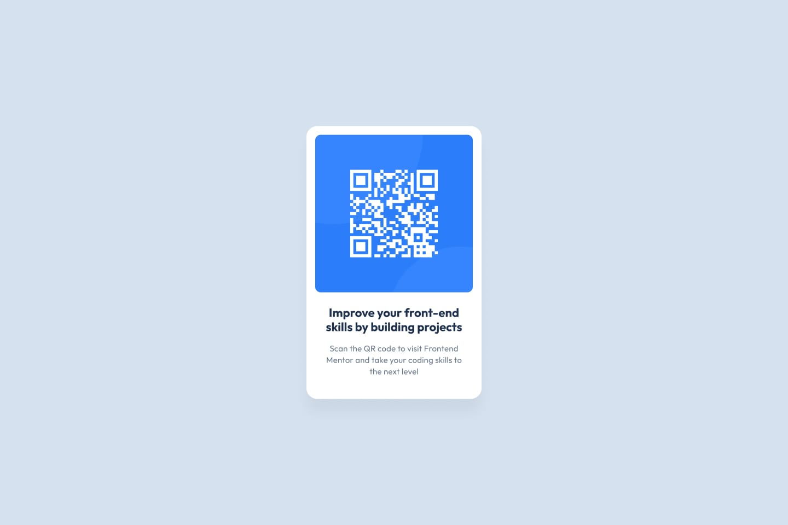

# Frontend Mentor - QR Code Component Solution

This is a solution to the [QR code component challenge on Frontend Mentor](https://www.frontendmentor.io/challenges/qr-code-component-iA_BxA1mG). Frontend Mentor challenges help you improve your coding skills by building realistic projects. 

## Table of contents

- [Overview](#overview)
  - [Screenshot](#screenshot)
  - [Links](#links)
- [My process](#my-process)
  - [Built with](#built-with)
  - [What I learned](#what-i-learned)
- [Author](#hdaberi)

## Overview

### Screenshot

 <!-- عکس پروژه خودت را در مسیر اصلی بگذار و نامش را اینجا ست کن -->

### Links

- Solution URL: [Add solution URL here](https://github.com/hdaberi/react-qr-code-app-project)


## My process

### Built with

- Semantic HTML5 markup
- CSS custom properties / Tailwind CSS <!-- اگر از تایل‌ویند یا CSS معمولی استفاده کردی اینجا مشخص کن -->
- Flexbox / CSS Grid
- Mobile-first workflow
- [React](https://reactjs.org/) - JS library

### What I learned

Building this component using React helped reinforce key concepts such as structuring component architectures, managing static assets in React, and applying responsive CSS layout techniques.

```jsx
function QRCodeCard() {
  return (
    <main className="qr-card">
      
      <h1>Improve your front-end skills by building projects</h1>
      <p>Scan the QR code to visit Frontend Mentor and take your coding skills to the next level</p>
    </main>
  );
}